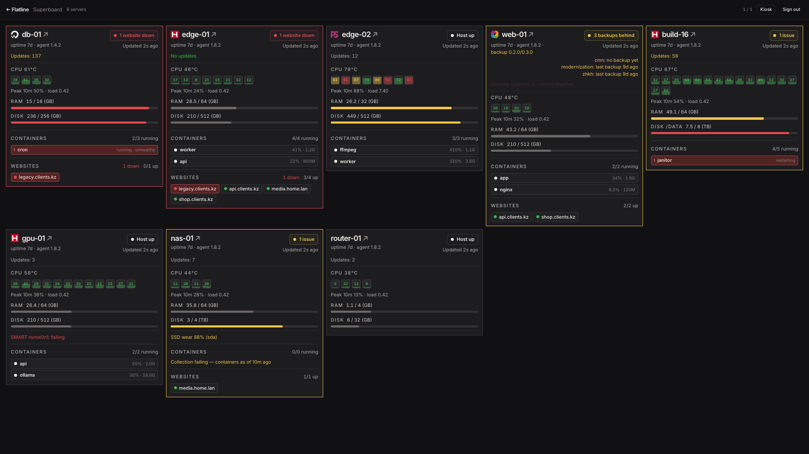
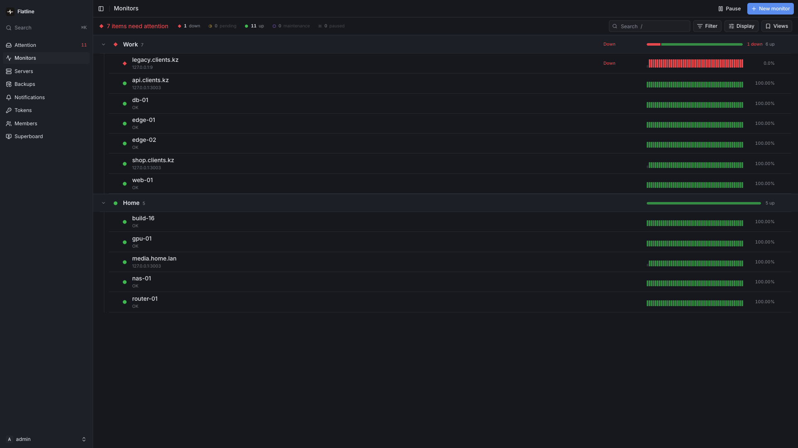
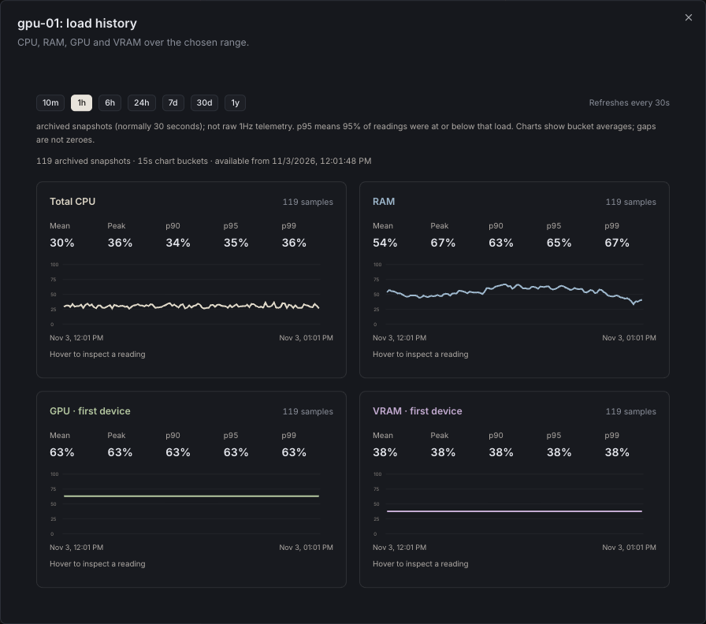

<div align="center" width="100%">
    
</div>

# KoreMonitor

Self-hosted uptime monitoring, live server telemetry and Telegram alerts in one
place: watch your endpoints, keep a live wall board of every host you run, and
know when a backup stops arriving.

Run it on one server and point your hosts at it. There is no agent port to open
and nothing to put in front of the sites you monitor.

The surface is small on purpose: the checks and the telemetry a small team
actually uses, and nothing else. See [docs/roadmap.md](docs/roadmap.md) for what
is deliberately not built.



**All screenshots use generated sample data**, not a production installation.

## What it is

Four pieces, one origin:

| Piece        | Dir             | What                                                                                                         |
| ------------ | --------------- | ------------------------------------------------------------------------------------------------------------ |
| Backend      | `backend-rs/`   | Rust service: the check engine, REST API, storage, alerts and both agents' downloads.                        |
| Web app      | `apps/web/`     | Next.js app: operator UI, Superboard, public status pages.                                                   |
| Host agent   | `superboard/`   | Single static Go binary pushed to each monitored server; sends telemetry, never accepts connections.         |
| Backup agent | `backup-agent/` | Separate Go binary on servers whose data you back up: exports Postgres and S3/Garage, uploads to the server. |

`./dev.sh` runs the backend and the web app locally, builds the agent binary
the server ships to hosts, and starts a mock fleet so the board has something
to show without real machines. Production is three containers behind one port:
Caddy on `:3001` sends `/api/*`, `/agent/*` and the other backend paths to the
backend and everything else to the web app. Both agents update themselves from
the builds the server ships.

## What you can do

- **Monitor** HTTP/HTTPS endpoints, ICMP hosts, groups and agent-pushed servers,
  with pending retries before a monitor turns DOWN, and Telegram alerts.
- **Watch CPU/RAM at 1 Hz on the Superboard**, with per-core squares, RAM and
  disk rows, container tiles, pending-update counts, SMART warnings and explicit
  telemetry freshness. Wall-mount a group on its own kiosk page
  (`/superboard/kiosk/work`, comma-separate scopes) and rename servers from the
  board.
- **Link the websites a server hosts** to its card and see their status as chips,
  with hosting-provider logos drawn next to the card title.
- **Open a server's history** with 10m / 1h / 6h / 24h / 7d / 30d / 1y ranges and
  p90 / p95 / p99, mean and peak summaries. Windows beyond a week read hourly
  rollups (two-year retention); peak stays the true maximum.
- **Get paged on sustained resource pressure**: per-server CPU/RAM/disk
  thresholds evaluated server-side, with 60s debounce, 30-minute cooldown,
  hysteresis and explicit recovery messages.
- **See agent trouble at a glance**: version, dropped samples, failed pushes and
  per-collector error counts on the card, with one right-click action to clear
  the warnings you have seen.
- **Back up the servers you run**: named backup agents export Postgres databases
  and S3/Garage buckets daily to the KoreMonitor server's storage, with optional
  age encryption, resumable uploads, retention and offline verify/restore. The
  Superboard shows each host's backup-agent version and a live "last backup …
  ago" line per agent, and flags a host whose backup is overdue or failed.
- **Serve public status pages** with password gates, per-page logos and accents
  (`/status/:slug`, plus host-routed custom domains). Serving and unlocking them
  is API-driven; creating or editing a page is a database operation, because
  there is no page-authoring API.
- **Drive everything over HTTP**: the REST API is the same one the web app
  uses, and `GET /api/v1/openapi.json` documents itself.





## Quick start

### Local development

Requires `cargo`, `go` and Node (Node runs the web app; the backend and the
agents do not use it).

```bash
git clone https://github.com/qarasky/kore-monitor.git
cd kore-monitor
./dev.sh
```

`./dev.sh` builds the backend and agent, starts the backend on `:3001` and the
web app on `:3003` (which forwards `/api` and `/agent` to the backend, so the
browser sees one origin). Export `KORE_ID_ISSUER` (and its client secret) before
starting, then sign in with Kore ID; see [docs/sso.md](docs/sso.md). The mock
fleet needs an operator API token: start the stack once, sign in, mint one in
**Tokens → New token**, then run `KOREMONITOR_TOKEN=kmon_op_... ./dev.sh`.
Without it the backend and web app still start and the mock fleet is skipped.
`./dev.sh stop` stops everything; `./dev.sh status` checks health.

### Docker

```bash
git clone https://github.com/qarasky/kore-monitor.git
cd kore-monitor
docker compose up -d --build
```

Three containers, one published port (**3001**, set with `KOREMONITOR_BIND` and
`KOREMONITOR_PORT`): `caddy` routes the backend's paths to `backend` (the API,
check engine and agent downloads) and everything else to `web` (the Next.js
app); only Caddy is published. Data lives in `./data`. Everyone Kore ID admits
becomes a full operator on first sign-in; who may use KoreMonitor is managed in
Kore ID's admin, and there is no seed script or bootstrap token. Configure
`KORE_ID_ISSUER` (and the client secret) before the first sign-in; see
[docs/sso.md](docs/sso.md).

Backup storage is opt-in: to accept uploads from backup agents, provision a
storage directory and add `-f docker/compose.backups.yaml` to every
`docker compose up` (see
[docs/deployment.md](docs/deployment.md#backup-storage)). Without it, backup
uploads answer 503 and everything else works.

### Without Docker

There is no single-binary mode. Run three things:

- the backend: `cargo run --release --manifest-path backend-rs/Cargo.toml`
  (data is SQLite in `./data`);
- the web app: `npm run build:web`, then `npx next start` in `apps/web/` (or
  the standalone server `apps/web/server.js` from `.next/standalone/`, laid out
  as [`docker/web.dockerfile`](docker/web.dockerfile) does), with `API_URL`
  pointing at the backend;
- a reverse proxy in front of both, routing as
  [`docker/Caddyfile`](docker/Caddyfile) does: `/api/*`, `/agent/*`, `/healthz`,
  `/add-push-server.md`, `/llms.txt` and `/robots.txt` to the backend,
  unbuffered; everything else to the web app.

### Updating

```bash
git pull --ff-only
docker compose up -d --build
```

Back up the database first. If you enabled backup storage, pass
`-f docker/compose.backups.yaml` to the `up` command as well, or the backend
loses its backup mount and uploads answer 503. Both agents update themselves
from the release the server ships; see [docs/agent.md](docs/agent.md) and
[docs/backup-agent.md](docs/backup-agent.md#self-update). The production
deployment is documented in [docs/deployment.md](docs/deployment.md).

## Sign in and tokens

People sign in to the web app **only with Kore ID** (the shared OpenID Connect
provider behind Kore, KoreMind, KoreCalendar and KoreMonitor). A first sign-in
provisions a full operator account; access is managed in Kore ID's admin. There
is no password, operator-token or first-account sign-in.

**Tokens** mints named operator API tokens (shown once) for scripts, machines
and agents: they authenticate `/api/v1` and the tokenized provisioning
documents, never a browser session. There is one level of access: every account
and every operator API token has full permission.

```bash
export KOREMONITOR_URL=http://localhost:3001
# Set KOREMONITOR_TOKEN privately; never commit or paste a real token.
curl -H "Authorization: Bearer $KOREMONITOR_TOKEN" "$KOREMONITOR_URL/api/v1/health"

# The provisioning runbook, ready to hand to a human or an LLM agent:
curl "$KOREMONITOR_URL/add-push-server.md?token=$KOREMONITOR_TOKEN"
```

`/llms.txt` is the same pointer file in `llms.txt` form. Both embed the token,
so they are token-gated rather than crawlable.

## Documentation

Everything lives in [`docs/`](docs/README.md):

| Document                                     | Read it when                                               |
| -------------------------------------------- | ---------------------------------------------------------- |
| [Architecture](docs/architecture.md)         | You want to know how the pieces fit and where data lives.  |
| [API](docs/api.md)                           | You are calling KoreMonitor from a script or an agent.     |
| [Host agent](docs/agent.md)                  | You are installing, configuring or debugging `superboard`. |
| [Backup agent](docs/backup-agent.md)         | You are installing or restoring a backup agent.            |
| [Superboard](docs/superboard.md)             | You are changing or explaining the wall board.             |
| [Web app](docs/dashboard.md)                 | You are working on the operator UI.                        |
| [Status pages](docs/status-pages.md)         | You are publishing or theming a public page.               |
| [Deployment](docs/deployment.md)             | You are shipping a release to a server.                    |
| [Operations](docs/operations.md)             | You are backing up, rotating a token or rolling back.      |
| [Development](docs/development.md)           | You are running, testing or releasing the code.            |
| [Provisioning runbook](docs/provisioning.md) | You are adding hosts (also served by the API).             |
| [Roadmap](docs/roadmap.md)                   | You want to know what is deliberately not done.            |
| [Screenshots](docs/screenshots/README.md)    | You want the images and how they were made.                |

## Licence

KoreMonitor is released under the MIT licence; see [LICENSE](./LICENSE).
Security reporting: [.github/SECURITY.md](.github/SECURITY.md).
