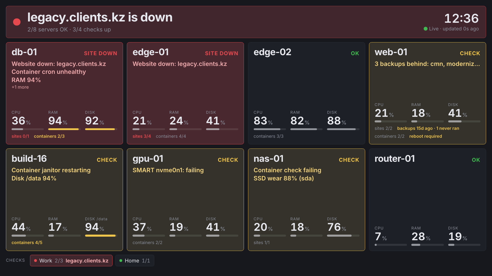

# Superboard

The fleet board: one card per server that pushes telemetry. It is a route in
the [web app](dashboard.md) (`apps/web/`), not a separate application, with its
own full-screen layouts on kore-ui components and tokens. The agent that fills
the cards is documented in [agent](agent.md). There are two layouts over the
same data:

| Route               | Layout                                                        | Use                                                      |
| ------------------- | ------------------------------------------------------------- | -------------------------------------------------------- |
| `/superboard`       | Header with navigation, detailed [cards](#card-anatomy)       | Desk use and setup: menus, history, rename, mute.        |
| `/superboard/kiosk` | [Kiosk](#kiosk): verdict band, tiles, checks strip; no chrome | The wall screen, read from across a room, never touched. |

Both accept a comma-separated group scope: `/superboard/kiosk/work`,
`/superboard/kiosk/work,personal`. Scopes match a monitor group by slug
(`Clinic North` → `clinic`) or case-insensitive exact name; only
`type: "group"` monitors match, and an unknown scope shows nothing rather than
everything. Without a scope the board shows every server.



## Kiosk

The wall layout answers one question for someone walking past: is anything
wrong, where, and why. It is display-only (no menus, dialogs, hover or
pause-on-touch, and the pointer is hidden) and everything on it scales with the
screen, so the same URL works on a TV across the room and on a desk monitor.
Code: `components/superboard/kiosk-board.tsx`, wording in `lib/kiosk-board.ts`.

```
┌──────────────────────────────────────────────────────────────┐
│ ● bakery.example is down                               14:32 │ ← verdict band
│   6/7 servers OK · 37/38 checks up · 1 muted   ● Live · 2s   │
├──────────────────┬──────────────────┬────────────────────────┤
│ bakery SITE DOWN │ shop-img CHECK   │ web-01              OK │ ← one tile per
│ Website down:    │ Disk 91%         │                        │   server, sized
│   bakery.example │ Backup overdue   │                        │   to fill the
│ CPU  RAM  DISK   │ CPU  RAM  DISK   │ CPU   RAM   DISK       │   screen
│ 34%  61%  48%    │ 12%  44%  91%    │ 8%    37%   22%        │
│ sites 2/3        │ backup 40h ago   │ containers 9/9         │
├──────────────────┴──────────────────┴────────────────────────┤
│ CHECKS  ● bakery 4/5 · bakery.example  ● ACME 3/3  ● cms 6/6 │ ← checks strip
│ KNOWN · MUTED ● Clinic North: clinic.example down · muted 2d │ ← muted outages
└──────────────────────────────────────────────────────────────┘
```

- **Verdict band.** One sentence: the down monitor (`bakery.example is down`,
  `3 down: a, b, c`), else the server that needs a look and why
  (`shop-images: Disk 91%`, `2 servers need a look: …`), else
  `All systems OK`. A website that is both a tile's link and a check on the
  strip is counted once. Under it, the counts. Red, amber or neutral, with the
  24-hour clock and the live indicator on the right.
- **Server tiles.** Name, a corner word (`OK`, `DOWN`, `SITE DOWN`,
  `SITES DOWN`, `CHECK`, `MUTED`, `MAINT`), up to three problems in words, then
  CPU, RAM and the fullest disk as large percentages with bars, and a line of
  small notes (`sites 2/3`, `backup 3h ago`, `containers 5/5`,
  `reboot required`, `security updates 6`). Healthy tiles are plain; trouble
  fills the tile (red for down, amber for check). This is the deliberate
  opposite of the desk card's 1px border rule: on a wall the exception has to
  win at a glance. Tiles keep the board's fixed order, so a server never moves
  on the wall.
- **Problems** come from the same rules as the desk card's attention, in this
  order: host down, websites down, no data for a while, failing containers,
  container collection failing, SMART, CPU/RAM/disk at 90% or more, backups
  behind (several collapse to one line), pending host or websites. Security
  updates and reboot-required are notes, not problems, because they do not
  raise attention on the desk card either.
- **Checks strip.** Every active monitor that is not a server tile or a group,
  one chip per parent group (`ACME 3/3`); a chip with down checks turns red
  and names them. Checks outside any group share an `Other` chip. The board's
  group scope applies.
- **Known · muted.** A [muted](#muting-a-known-outage) outage leaves the red:
  a muted server shows a quiet `MUTED` tile and muted checks stay grey on the
  strip, and each appears once on this line with how long ago it was muted.
- **No live data.** When the live stream has been down for 20 s, or every
  server's data has gone stale at once, the whole board dims and says
  `No live data` with the time of the last reading, so a frozen wall can never
  pass for a healthy one. One silent server is that server's `No data for …`
  problem instead.
- **Fit.** Columns and rows are chosen to make the tiles as large as possible
  (full rows preferred over a slightly larger layout with holes). Only when
  tiles would shrink below readable does the board paginate, rotating every
  `rotate` seconds.

### What the kiosk leaves out, and where it is

| Detail                                                       | Where                                                        |
| ------------------------------------------------------------ | ------------------------------------------------------------ |
| Per-core squares, CPU temperature, 10-minute peak, load      | Desk card; server page (`/servers/<id>`) → Now               |
| Agent version, host uptime, update counts, agent warnings    | Desk card; server page → Agent                               |
| Backup-agent versions and self-update state                  | Desk card; Backups (`/backups`, `/backups/<id>`)             |
| Per-backup-agent "last backup" lines                         | Desk card; server page → Backups                             |
| Container rows with CPU and memory                           | Desk card (two busiest or failing); server page → Containers |
| Every disk mount, RAM/disk in bytes, GPUs                    | Server page → Now                                            |
| Provider logo                                                | Desk card; server page                                       |
| History, rename, mute, linked websites, clear agent warnings | Desk board menus and dialogs; server page                    |

## Which monitors appear

A card is any monitor with a recent telemetry sample. Groups are never cards
(the board lists monitors, skips `type: "group"`, and asks for `metrics/latest`
for the rest; a 404 means "not a server" and is dropped). A host that stops
pushing ages out by itself, so no configuration decides membership.

Order follows the monitor tree: parent group `weight`, then the monitor's own
`weight`, then name, so the board never reshuffles between refreshes.

## Card anatomy

The desk board (`/superboard`) card:

```
┌───────────────────────────────────────────────────────────────┐
│ ⬢ web-01 ↗                            ● Host up               │
│   uptime 11d · agent 1.8.3 · backup 0.3.4   Updated 2s ago    │
│                                portal: last backup 3h ago     │
│                                harbor: last backup 2h ago     │
│                                                               │
│ Security Updates: 6 · reboot required      ← flags line       │
│                                                               │
│ CPU 48°C                                                      │
│   [33][27][35][19][ ][ ][ ][ ]            ← per-core squares  │
│   Peak 10m 34% · load 0.42                                    │
│                                                               │
│ RAM 9.5 / 64 (GB)                                             │
│ ▬▬▬▬▬▬▬▬▬░░░░░░░░░░░░░░░░░░░░░░░░░░░░░░░░                     │
│                                                               │
│ DISK 210 / 512 (GB)                                           │
│ ▬▬▬▬▬▬▬▬▬▬▬▬▬▬▬▬░░░░░░░░░░░░░░░░░░░░░░░░░                     │
│                                                               │
│ CONTAINERS                                    2/2 running     │
│ ● app        34% · 1.6G                                       │
│ ● nginx       6% · 120M                                       │
│                                                               │
│ WEBSITES                                      1 down · 1/2 up │
│ ● api.example.com   ● shop.example.com                        │
└───────────────────────────────────────────────────────────────┘
```

- **Title** is the monitor's display name (renamable from the board); the agent's
  reported hostname stays read-only and appears in the tooltip. `↗` opens the
  history dialog.
- **Subline** is uptime, agent version and, on a server with backup agents, the
  backup-agent version (`backup 0.3.4`; `backup 0.3.3/0.3.4`, lowest first, while
  an update is half done; amber when the host's self-update is failing, with the
  reason on hover), nothing else. OS and core count are noise the operator can
  get from the machine.
- **Backup lines** sit under the freshness, one per backup agent linked to the
  server's monitor: `portal: last backup 3h ago`, or just
  `last backup 3h ago` when there is one agent. They tick like "Updated".
  `no backup yet` before the first completed backup, `backups off` for a
  disabled agent; amber when the server calls the agent `overdue` (more than
  36 h since its last completed backup) or `failed`. Hover shows the exact time,
  the health and the last error code. Agents with a revoked token are not shown.
- **Status pill**: `Host up`, `Host down`, `Pending`, `Maintenance`, or a
  website-derived headline (`1 website down`, `2 websites pending`) when the
  hosted sites are in worse shape than the host. Freshness sits beside it
  (“Updated 2s ago”, or amber “Stale · 4m ago”).
- **Flags line** carries the update status and the agent warning, side by side.
- **CPU**: per-core squares with the load printed inside each, the package
  temperature in the label, and a `Peak 10m` line with the load average.
- **RAM** and **Disk** are each one full-width row: label, `used / total` figure
  on the line, slim bar underneath. Disk shows the fullest mount.
- **Containers** and **Websites** sections appear only when they have something
  to say.

Squares, not just colours: every bar and chip carries a number or a symbol so the
board does not depend on colour alone.

### Attention and freshness

Attention is expressed by the card's 1px border and the headline, never by a
thicker accent: a troubled card must not be heavier than its neighbours.

| Attention           | When                                                                                                                                                                  |
| ------------------- | --------------------------------------------------------------------------------------------------------------------------------------------------------------------- |
| Bad (red border)    | Host down, or a linked website is down.                                                                                                                               |
| Muted (dark red)    | Bad, but every down monitor on the card is [muted](#muting-a-known-outage).                                                                                           |
| Warn (amber border) | Stale data, container issues, sustained high usage (≥90% on any of CPU/RAM/disk/GPU), pending status, a linked website pending, or a backup agent `overdue`/`failed`. |
| Normal              | Healthy.                                                                                                                                                              |

A backup that is behind also counts towards the board's "need attention"
total, and names itself in the headline (`Backup overdue`, `2 backups behind`)
when nothing more severe applies: host down, websites down, stale data and
container issues come first.

Freshness is separate from reachability: a sample is stale after
`max(5s, sampleInterval × 3)` when the agent reports its interval, otherwise
after `max(60s, the monitor's interval)`. A stale card keeps its last readable
numbers with an amber warning rather than blanking out.

### Updates line

Read-only, from the agent's package-manager checks:

| Label                                | Meaning                                                                     |
| ------------------------------------ | --------------------------------------------------------------------------- |
| `No updates` (green)                 | Report is known and zero.                                                   |
| `Updates: N` (grey)                  | Fewer than 50 pending.                                                      |
| `Updates: N` (amber)                 | 50 or more pending.                                                         |
| `Security Updates: N` (red)          | At least one security advisory.                                             |
| `… · reboot required` (flashing red) | The host must restart to finish applying updates; this outranks the counts. |

An absent field means unknown (unsupported distribution, failed check) and
renders nothing: a blind agent never reads as fully updated.

### Agent warnings

One amber line summarises what the agent reports about itself: dropped samples,
failed pushes and non-docker per-collector errors, with per-collector detail in
the tooltip. Docker collector failures are shown once, in the containers
section, instead of twice.

Right-clicking a card offers **Clear agent warnings (N)**, which acknowledges
the current counters so the line disappears. Only failures past the
acknowledged point bring it back; an agent restart drops the acknowledgements
rather than hiding new ones. The count in the menu is the same count the line
prints.

### Muting a known outage

Some outages are known and cannot be fixed yet (a client who stopped paying, a
box waiting for a part). Right-click a red card and choose **Mute**; the same
action is on a down monitor's detail view in Monitors.

- The card turns **dark red** (border and status badge) and shows
  `muted 2d ago` under the badge. It still reads as broken.
- It leaves the header's "down" and "need attention" counts and is counted as
  `N muted` instead. A server whose host is up and only a website is muted
  still counts when it has a problem of its own (stale data, containers, high
  usage, backups behind).
- Telegram stops repeating what was muted: resend reminders for the muted
  monitors, a group whose down monitors are all muted, and, when the host
  itself is down and muted, the server's CPU/RAM alerts and its backups'
  `failed`/`overdue` alerts. Recovery messages are always sent.

A mute ends by itself. Anything new and substantial on the card deletes it and
alerts as usual: another linked monitor going down, a disk newly failing SMART,
or a mount newly reaching the disk-full level (the monitor's disk alert
threshold, or 90% when none is set). A disk that was already failing or full
when you muted does not end it, and neither does a sample that reports no
disks (an agent that just restarted). A mute ended by a disk is announced in
Telegram (`[🔴 MUTE ENDED] … [/dev/sdb failing SMART]`), since a failing disk has
no alert of its own. Each muted monitor that recovers drops out of the mute, so
a later outage is new; when nothing muted is still down, the mute is gone.
**Unmute** (same menu) ends it by hand.

Muting a group from Monitors mutes the monitors down inside it; one going
down later ends the mute. The mute is stored on the server, so every screen, the
wall included, shows it.

### Provider logos

A monitor's `provider` id (usually a domain, e.g. `hetzner`, `hoster.example`) draws that
provider's symbol before the title: transparent, no badge, sized with the title
text. Bundled logos live in `apps/web/public/providers/` and are listed in
`apps/web/lib/providers.ts`; a provider the catalogue does not know but
that looks like a domain falls back to that site's favicon, so adding a provider
is an edit rather than a release. Unknown slugs draw nothing, and a favicon that
cannot load (offline kiosk) collapses to no logo instead of a broken image.

## Containers

At most two rows, one container each, so the full name is never truncated.
Failing containers always fill the rows first; when nothing is failing, the two
busiest running containers take them (CPU first, memory as the tie-break).
Stopped containers are not listed: without an expected-running policy they
express intent, not failure, and would crowd out live signal.

The right side of a row carries the failing state (`running · unhealthy`,
`restarting`, `dead`) or, for a healthy row, the live CPU/memory reading. When
the agent cannot reach Docker at all, the section stays and says so, with how
old the last successful collection is. A card with no running containers and no
error shows no container section at all.

## Hosted websites

A server can be linked to the websites it hosts; they render as status chips,
worst-first, and their trouble degrades the card (a down website gives the card
a red border and a headline naming it).

Right-click → **Manage websites…** opens a searchable picker. Only HTTP/HTTPS
monitors are offered, never other servers or ping checks, and a group is offered
only when it actually contains a website somewhere below it. Linking a group
links every website inside it, including ones added later, so the chips stay
current without re-linking.

## History dialog

On the desk board, selecting a server name opens a keyboard-accessible dialog
(Escape closes it; page rotation pauses while it is open). Ranges are 10m, 1h, 6h, 24h, 7d, 30d
and 1y, with mean, peak and p90/p95/p99 summaries. Percentiles come from
archived readings (normally every 30 s), not from downsampled chart averages or
raw 1 Hz samples; missing readings are gaps, never zeroes. Only the open dialog
refreshes while it is open, and the live board keeps updating independently.

## Metric threshold alerts

Per-server CPU, RAM and disk thresholds, configured in the monitor edit form
(Advanced → Metric alert thresholds) or over the API. Alert-only: they never
flip a monitor's status or write heartbeat rows, so the host-down path stays the
only thing that can take a monitor down.

- Fires when the value stays at or above the threshold for 60 seconds.
- Recovery is declared at threshold − 5 points (hysteresis), and the hysteresis
  band itself is silent rather than printing “88% ≥ 90%”.
- While still breached, it repeats at most every 30 minutes.
- Maintenance and paused states do not suppress evaluation, but a suppressed
  episode never sends a lone recovery message.
- Disk alerts name the fullest mount; evaluation uses receive time, so a
  backfilled backlog cannot replay old alert timelines.

State is in-process and bounded; an agent or backend restart may re-send one
alert after the debounce.

While a server's host is muted (it is down and part of a
[mute](#muting-a-known-outage)), its CPU and RAM alerts are not sent. Disk
alerts always are.

## Auto-pagination and parameters

On the desk board, page size is measured from the viewport against a 340×420
minimum card, with a floor of ten hosts so a tall card cannot shrink the fleet
to one row per page. Small fleets stay on one page instead of rotating. The
kiosk sizes its tiles itself (see [Fit](#kiosk)) and ignores `perPage`.

| Query parameter | Default  | Meaning                                                                                                                                                                                 |
| --------------- | -------- | --------------------------------------------------------------------------------------------------------------------------------------------------------------------------------------- |
| `rotate`        | `5`      | Seconds between pages (1–300). Pauses while the tab is hidden. On the desk board rotation also pauses on any interaction and resumes after 30 s idle; the kiosk never pauses for input. |
| `perPage`       | measured | Desk board only: explicit page size override.                                                                                                                                           |

A kiosk with no session shows the Kore ID sign-in; see
[signing in](dashboard.md#signing-in).

The kiosk is chrome-free, never scrolls and hides the pointer. Reaching it is a
route, not a parameter.

## Not shown on the card

- **GPU tiles.** The tile code is intact and gated behind a flag; the data is
  collected and stored.
- **Network and disk I/O throughput.** Collected, derived and stored (as the
  basis for future traffic statistics), but the card deliberately keeps to CPU,
  RAM and disk.
